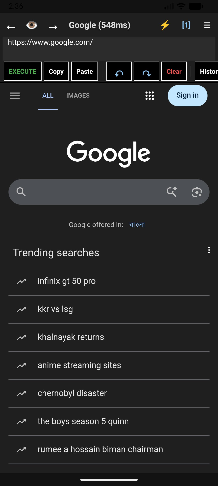
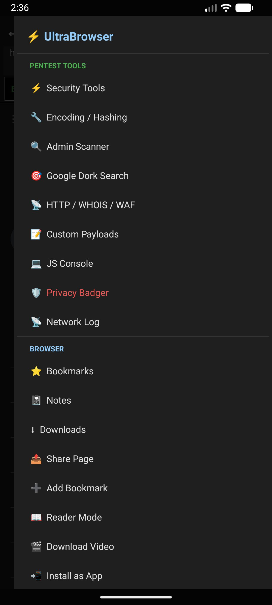
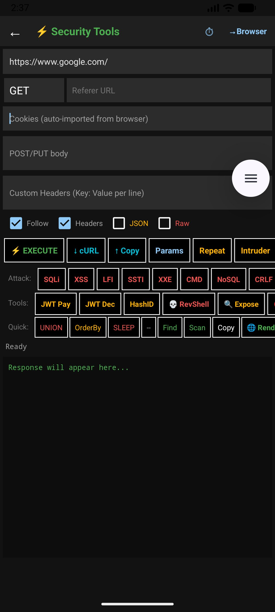
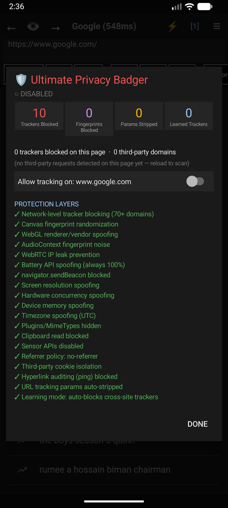
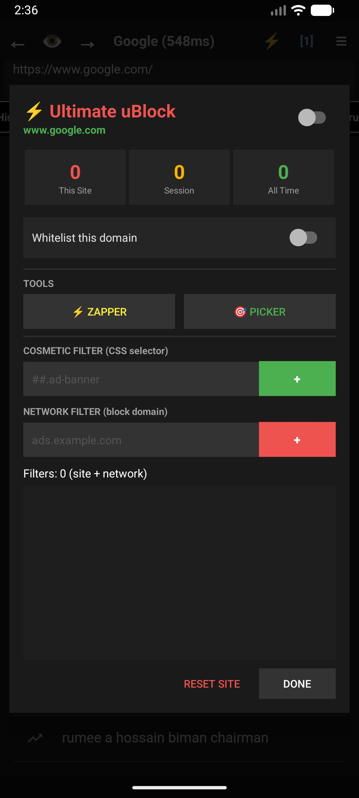

# UltraBrowser

An Android browser with privacy controls, cookie editing, downloads and web tools.

[Download the APK](https://github.com/savaskarofficial/UltraBrowser/releases/download/1.8.5/UltraBrowser-1.8.5-release.apk) | [Google Play](https://play.google.com/store/apps/details?id=com.ultra.browser) | [Release notes](CHANGELOG.md) | [Report an issue](https://github.com/savaskarofficial/UltraBrowser/issues)

**Latest release: 1.8.5**
**Requires Android 7.0 or newer.**

This repository hosts official APK releases, documentation and issue reports. Application source files, source archives and Android App Bundles (AABs) are not published here.

## Browsing

- Tabs with page previews, favicons, search, groups, suspension and recently closed pages.
- Saved normal sessions, including previews and favicons after an app restart.
- Desktop and reading modes with visible On/Off states.
- A search-engine picker in the address bar, with the same choices as Settings. Selecting an engine opens its home page.
- Back and Forward beside the eye control. Tap the eye to choose a user agent; hold it to hide or show the address bar and tools.
- Find in page, sharing, bookmarks, notes, page source, local page-text editing and screenshots.
- An eleven-step tutorial that marks the controls and explains tap and hold gestures.
- Compact Material dialogs and forms, with saved-page content kept clear of system bars.

## Cookies, site settings and saved data

The cookie manager lets you search, inspect, add and edit cookies. Where WebView exposes cookie attributes, edits preserve their original domain and path. Writes are validated and failures are reported.

The floating cookie icon is a native app control. It works with page JavaScript disabled and stays within the page after rotation or resizing. Tap the toolbar cookie icon to show or hide it, or hold it to open the manager.

Site settings control JavaScript, third-party cookies, pop-ups, desktop layout and content blocking. Account profiles keep separate sign-ins and site storage. Private tabs use a separate WebView profile and are excluded from saved normal history, sessions and thumbnails. Profile features need a compatible WebView provider.

Bookmarks and notes support search, organization, import and export. Notes also support password-protected backups. Saved offline pages and PDF printing are available from the browser menu.

Cookie and storage snapshots include WebView-visible cookies plus local and session storage. They do not copy IndexedDB or service workers. A restored tab may reload, so unsaved forms and page memory can be lost.

## Privacy controls

UltraBrowser includes domain blocking, an optional downloadable blocklist, site exceptions, tracking-parameter removal, link-ping removal and page fingerprinting controls. These controls depend on WebView and the website; they do not make browsing anonymous.

The website location override starts Off with no preset coordinates. It supplies the coordinates you enter through the website's JavaScript geolocation API. It does not change device GPS, your IP address or other apps. Sites can be blocked from using the override.

This release requests no device camera, microphone or location permission. Website features requiring those permissions are unavailable. Photo uploads open an installed camera app instead.

## Downloads

The download queue supports pause and resume, scheduling, Wi-Fi restrictions, connection limits, destination folders and SHA-256 checks. Resume depends on the server supporting compatible range requests and unchanged content.

Supported unencrypted HLS and DASH downloads include quality and audio selection and MP4 assembly. Live streams, DRM and encrypted media are not supported. Website and device codec support still apply.

Downloads run while the app is visible and through ordinary Android jobs in the background. Android may delay or stop background work. Open the app to resume promptly, including after a reboot or force-stop.

## Web tools

The app includes a request editor, response-header checks, network probes, encoding and hashing helpers, JWT tools, request-history metadata and the Eruda and vConsole page consoles.

Request history contains the metadata WebView exposes, rather than a complete network capture. Page consoles and filters do not provide desktop extension support. Use testing tools only on systems you own or have permission to test.

## Screenshots

These screenshots show an earlier interface. Controls and dialog layouts have changed in 1.8.5.

| Browser | Menu | Web tools |
| --- | --- | --- |
|  |  |  |

| Privacy controls | Content blocking |
| --- | --- |
|  |  |

## Install and update

Download the signed APK from [Releases](https://github.com/savaskarofficial/UltraBrowser/releases/latest), or use the [Google Play listing](https://play.google.com/store/apps/details?id=com.ultra.browser).

| Release | Version code | Minimum Android | Target SDK |
| --- | --- | --- | --- |
| 1.8.5 | 26 | Android 7.0 (API 24) | Android 16 (API 36) |

The GitHub APK is signed with the same certificate as the previous official GitHub release. Android updates require a matching signing certificate; a debug-signed build cannot be updated in place with this release.

SHA-256 for `UltraBrowser-1.8.5-release.apk`:

```text
4d9a8278aa0208fb0c3ae1082b6ae2e16da63af8b90a0b8a8d7572a05e48ee22
```

The requested permission set remains within the published 1.7.0 APK's set, including the same storage SDK limits. Website features also depend on the installed Android System WebView.

## Support

[Open an issue](https://github.com/savaskarofficial/UltraBrowser/issues) with the app version, Android version, WebView version and steps to reproduce the problem. Include the expected result and what happened. Remove passwords, cookies, tokens and private browsing details from screenshots and logs before sharing them.

## Developer and license

UltraBrowser is developed by **Sharodshahi Al-Amin**, Undercover IT Firm.
GitHub: [savaskarofficial](https://github.com/savaskarofficial)

UltraBrowser is proprietary software. See [LICENSE](LICENSE) for the terms. The editable application source is not available in this repository.
